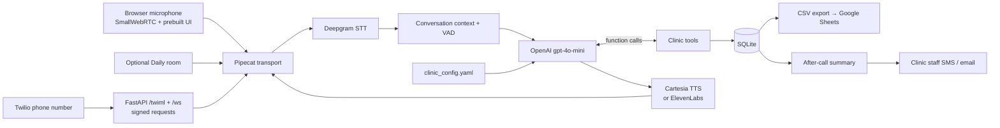

# Clinic Voice Receptionist

**A welcoming front desk, even when the front desk is busy.**

A working voice AI demo for dental and medical clinics: answer questions about hours, services, prices and insurance; capture appointment requests; take messages; and send staff a post-call summary. Start in your browser, then connect a Twilio number.

Built by **Arthi Arumugam**, contributor to [Pipecat #5163](https://github.com/pipecat-ai/pipecat/pull/5163) and [LiveKit #6663](https://github.com/livekit/livekit/pull/6663).

> **Demo scope:** appointment requests are saved to SQLite as `pending_confirmation`. This is not connected to a clinic calendar or EHR. Use fictional callers and clinic details. The receptionist identifies itself as AI, is instructed never to give medical advice, and directs emergencies to local emergency services: **911 / 000 / 999**.

## What’s included

- **Natural voice conversation:** Deepgram transcription → OpenAI `gpt-4o-mini` with function calling → Cartesia speech. ElevenLabs is an optional alternative.
- **Three ways to connect:** SmallWebRTC with Pipecat’s prebuilt browser UI by default, optional Daily rooms, and Twilio bidirectional phone audio through FastAPI.
- **One clinic configuration:** trusted YAML controls the clinic’s name, timezone, hours, services, prices, address, insurance and emergency policy.
- **Five tools:** `get_hours`, `list_services`, `book_appointment`, `take_message`, `end_call`.
- **Practical persistence:** consent checks, future dates, opening hours, service durations, daylight-saving validation, atomic overlap protection and idempotent retries.
- **After-call follow-up:** optional Twilio SMS plus either Resend or SMTP email to clinic staff. Missing credentials skip that channel; delivery failures do not undo saved requests.
- **Portable data:** spreadsheet-safe CSV export ready for Google Sheets.
- **A separate sales site:** responsive Next.js App Router, TypeScript and Tailwind landing page, with an explicitly simulated conversation preview and email CTAs.

## Architecture



The backend is pinned to **`pipecat-ai==1.14.0`**, verified against the live package registry and release source on **24 October 2026**. It uses the current `PipelineWorker` / `WorkerRunner`, universal context aggregators, `FunctionSchema`, and service `Settings` APIs. See the [release](https://github.com/pipecat-ai/pipecat/releases/tag/v1.14.0) and [official function-calling example](https://github.com/pipecat-ai/pipecat/blob/v1.14.0/examples/getting-started/07-function-calling.py).

## Quick start: browser first

Use Python **3.11–3.13** (3.12 recommended), a microphone, headphones, and funded Deepgram, OpenAI and Cartesia accounts. The site needs Node **20.9+** and npm. The browser demo does not require Daily or Twilio.

```bash
python3 -m venv .venv
source .venv/bin/activate          # Windows PowerShell: .venv\Scripts\Activate.ps1
python -m pip install -e '.[dev]'
cp .env.example .env              # Windows PowerShell: Copy-Item .env.example .env
```

Set these four values in `.env`:

```dotenv
DEEPGRAM_API_KEY=your-key
OPENAI_API_KEY=your-key
CARTESIA_API_KEY=your-key
CARTESIA_VOICE_ID=your-voice-id
```

Choose a voice ID from your Cartesia dashboard, then run:

```bash
python bot.py
```

Open **[http://localhost:7860/client/](http://localhost:7860/client/)**, connect, and allow microphone access. `python bot.py` explicitly selects WebRTC; `python bot.py -t webrtc` is equivalent. The Pipecat runner supplies the UI and signaling server. The `site/` landing page is separate.

Try “What time do you close on Friday?”, “How much is a cleaning?”, or “I’d like to request a dental exam next Monday.” Use a future weekday, say a full date when asked, and confirm the details before anything is saved. Finish with “That’s all, goodbye.”

If microphone permission fails, use localhost or HTTPS and check browser permissions. Remote WebRTC deployments may need TURN; see the [Pipecat runner guide](https://docs.pipecat.ai/api-reference/server/utilities/runner/guide). Keep the development runner local: it is not an authenticated public service.

For reproducible dependency installation, the repo includes `uv.lock`:

```bash
uv sync --extra dev --locked
uv run bot.py
```

## Phone demo: Twilio

1. Set `TWILIO_ACCOUNT_SID`, `TWILIO_AUTH_TOKEN` and `TWILIO_PHONE_NUMBER` in `.env`, in addition to the voice keys. Use a Twilio number with Voice enabled; trial-account restrictions still apply.
2. Expose port 8000 through an HTTPS tunnel, for example `ngrok http 8000`.
3. Set `PUBLIC_BASE_URL=https://your-tunnel.ngrok-free.app` to its exact public origin, without a path.
4. Run `python server.py`. The browser runner is independent and uses port 7860.
5. In the number’s Voice configuration, set **“A call comes in” → Webhook → POST** to `https://your-tunnel.ngrok-free.app/twiml`.
6. Call the number. The webhook returns `<Connect><Stream>` for `wss://your-tunnel.ngrok-free.app/ws`.

```bash
python server.py
# Separate terminal: a health check that does not call any AI provider
curl http://localhost:8000/health
```

Both the webhook and WebSocket handshake validate `X-Twilio-Signature` against the configured public URL. Unsigned `curl` requests to `/twiml` deliberately return 403. A stale tunnel hostname, HTTP instead of HTTPS, or an incorrect token will also fail validation. There is no signature-bypass switch. See [Twilio’s security guidance](https://www.twilio.com/docs/usage/security).

Pipecat’s Twilio serializer handles 8 kHz μ-law conversion, interruption messages and automatic hangup. `end_call` drains the goodbye audio before ending; caller disconnects cancel the session. A default ten-minute limit bounds demo calls, and the runner’s idle timeout is five minutes. Saved outcomes are finalized and notifications attempted on normal completion, disconnect and handled failures. Abrupt process termination can interrupt finalization; this demo has no durable notification retry queue.

## Optional Daily and ElevenLabs

```bash
# Daily: set DAILY_API_KEY, then use its runner UI
python -m pip install -e '.[daily]'
python bot.py -t daily

# Alternative TTS: set TTS_PROVIDER=elevenlabs,
# ELEVENLABS_API_KEY and ELEVENLABS_VOICE_ID
python -m pip install -e '.[elevenlabs]'
python bot.py
```

Cartesia credentials are not required when ElevenLabs is selected. All model overrides and optional keys are listed in [`.env.example`](.env.example).

## Configure your clinic

Edit [`clinic_config.yaml`](clinic_config.yaml), then start a new call. The supplied Willow Dental & Medical clinic and business details are fictional examples.

| Field | Meaning |
| --- | --- |
| `name`, `address` | Caller-facing clinic identity and location |
| `timezone`, `currency` | IANA timezone and three-letter currency code |
| `hours` | All seven lowercase weekdays; `open` / `close` in quoted `HH:MM`, or `null` for closed |
| `services` | Unique `id`, display `name`, nonnegative `price`, `duration_minutes` |
| `insurance` | Participation examples; never a guarantee of caller coverage |
| `emergency_policy`, `emergency_numbers` | Administrative emergency response; retain 911, 000 and 999 |

Invalid or incomplete configuration fails early. Caller speech cannot edit these settings. The prompt incorporates the current clinic-local date to interpret relative dates, asks one question at a time, requires a read-back and explicit consent, and tells the caller to wait for staff confirmation.

The local booking model has **one shared appointment capacity**. Overlapping pending requests are rejected, including across concurrent SQLite connections. Holidays, multiple clinicians, rescheduling and live availability are outside this demo. Staff reconcile requests manually; CSV export does not synchronize a calendar.

Useful environment options:

| Key | Default / use |
| --- | --- |
| `CLINIC_CONFIG_PATH` | `clinic_config.yaml`, relative to the repo |
| `DATABASE_PATH` | `data/clinic.sqlite3`, created on the first call |
| `OPENAI_MODEL` | `gpt-4o-mini` |
| `DEEPGRAM_MODEL` | `nova-3-general` |
| `CARTESIA_MODEL` | `sonic-3.6` |
| `MAX_CALL_SECONDS` | `600`, supported range 30–3600 |
| `LOG_LEVEL` | `WARNING`; debug logs may reveal conversation content |

### Staff notifications

SMS needs the three `TWILIO_*` credentials plus `CLINIC_NOTIFY_PHONE` in E.164 format. Email needs `CLINIC_NOTIFY_EMAIL` and either:

- **Resend:** `RESEND_API_KEY` and `RESEND_FROM_EMAIL` on a verified sender domain.
- **SMTP:** `SMTP_HOST`, `SMTP_PORT`, `SMTP_FROM`, and optional `SMTP_USERNAME` / `SMTP_PASSWORD`. `SMTP_SECURITY=starttls` uses port 587 by default; choose `ssl` and port 465 when required.

When both email providers are configured, Resend is used. SMS and email are independent. Notifications default to a call reference, status, appointment-request count and message count; **no names, phone numbers or message contents**. Set `NOTIFY_INCLUDE_DETAILS=true` only for an appropriate demo environment if you want the saved administrative details included. Recipients come from environment settings, never from the LLM or caller. There is no separate paid LLM summarization request.

### Export to Google Sheets

```bash
python scripts/export_csv.py --db data/clinic.sqlite3 --output exports/appointments.csv
python scripts/export_csv.py --db data/clinic.sqlite3 --table messages --output exports/messages.csv
```

In Google Sheets, choose **File → Import → Upload**, select the CSV, and import into a new sheet. Exports include headers, UTF-8 BOM, ISO timestamps in UTC and escaped formula prefixes. Phone numbers may have a leading apostrophe to preserve text safely. This is a manual import; no Google credentials or Sheets API integration are needed. Database and export files are gitignored.

## Landing page

```bash
cd site
cp .env.example .env.local
# Set NEXT_PUBLIC_CONTACT_EMAIL to your real sales address.
npm install
npm run dev
# Production verification
npm run build
```

Open [http://localhost:3000](http://localhost:3000). The page presents **1-week setup for $1,500, then $400/month, with a 14-day free pilot**. Its conversation preview is simulated; the working microphone demo is the Pipecat UI. The placeholder contact address is `hello@example.com` until configured.

For Vercel, import the repo, choose **`site` as the Root Directory**, retain the Next.js build defaults and set `NEXT_PUBLIC_CONTACT_EMAIL` before building. Only the marketing site belongs on Vercel. Run the persistent Python voice/WebSocket service on a host that supports long-lived connections. See [`site/README.md`](site/README.md).

## Estimated running cost

These are **illustrative USD estimates**, not current quotes or guaranteed plan prices. Usage, speaking ratio, growing conversation context, region, subscription tiers and vendor rate changes affect the result. Provider links below are the source to check before budgeting.

| Component | Approximate cost per call minute | Notes |
| --- | ---: | --- |
| [Deepgram STT](https://deepgram.com/pricing) | $0.0043–$0.0077 | Model, streaming tier and promotions vary |
| [OpenAI GPT-4o mini](https://developers.openai.com/api/docs/models/gpt-4o-mini) | ~$0.001–$0.005 | Small text-model allowance; token-billed, not minute-billed |
| [Cartesia TTS](https://cartesia.ai/pricing) | ~$0.03–$0.05 | Character/credit-billed; estimate depends on how much the bot speaks |
| [Twilio Voice, US local](https://www.twilio.com/en-us/voice/pricing/us) | ~$0.0085–$0.014 | Inbound vs outbound; separate Media Streams charges may apply |
| **Working phone-demo budget** | **roughly $0.05–$0.10/min** | A planning allowance, not a provider bundle |

Browser mode avoids Twilio voice charges. Phone-number rental, SMS, email, Media Streams, Daily, hosting, taxes and any minimum subscription commitments are additional. The landing page’s service offer is separate from these infrastructure estimates.

## Privacy, HIPAA and medical safety

**This repo is a demonstration, not a HIPAA-compliant deployment.** Do not use real patient information in the demo. A compliant production system requires appropriate vendor agreements, including BAAs where required, and a complete security and operational assessment; a vendor’s marketing claim alone is insufficient. Review [HHS guidance on cloud services and BAAs](https://www.hhs.gov/hipaa/for-professionals/special-topics/health-information-technology/cloud-computing/index.html).

Audio and text are processed by the configured providers. This application does not record audio or persist raw transcripts, but SQLite stores the caller’s voluntarily supplied administrative fields; provider retention policies remain separate. The demo database is not encrypted by this application and has no staff access UI, authentication, retention automation or audit portal. Keep databases and exports private and use fictional data. Ordinary SMS/email is not a default channel for patient information.

The receptionist’s prompt prohibits diagnosis, treatment advice and symptom triage. For emergencies it directs callers to **911 (US/Canada), 000 (Australia), or 999 (UK)**, or their local emergency number, without claiming to transfer the call or dispatch help. These are model instructions, not a clinically validated safety system. Before patient use, evaluate model behavior, establish human escalation, and address consent, retention, access controls and jurisdiction-specific requirements.

## Development and verification

```bash
python -m pytest -q
ruff check . --exclude site
ruff format --check . --exclude site
python -m compileall -q bot.py server.py config.py store.py tools.py notify.py settings.py
cd site && npm run build
```

Tests use temporary databases, fixed clocks and mocked notification providers; **no API keys or network calls are needed**. They cover configuration and safety prompts, booking consent and conflicts, persistence, CSV injection protection, notification failures, signed Twilio endpoints and voice-session glue. Paid provider connectivity and audible end-to-end quality still need a real call with your credentials. Use [`DEMO_SCRIPT.md`](DEMO_SCRIPT.md) for a one-minute walkthrough.

```text
bot.py                 Pipecat services, tools, lifecycle and browser runner
server.py              Signed Twilio /twiml and /ws endpoints
config.py              Validated YAML and system prompt
clinic_config.yaml     Fictional clinic facts
tools.py               Network-free tool schemas and business rules
store.py               SQLite calls, appointment requests and messages
notify.py              Best-effort staff SMS / SMTP / Resend
settings.py            Environment and URL validation
scripts/export_csv.py  Google Sheets-ready CSV export
tests/                 Offline pytest suite
site/                  Next.js marketing page
```
